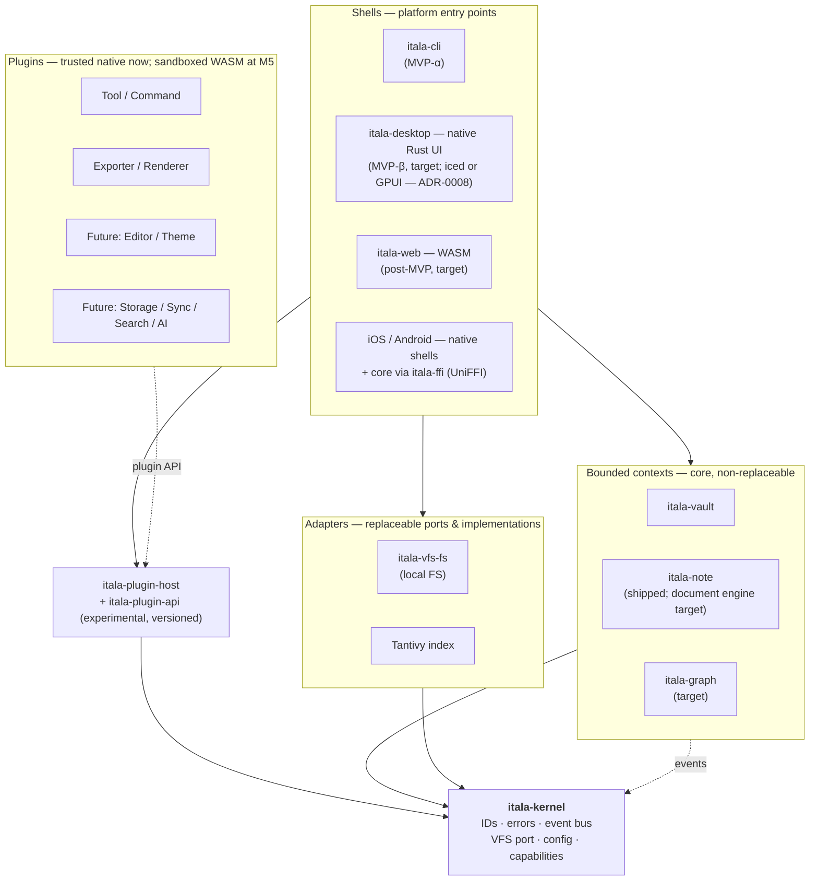

# Architecture

> **Audience:** a contributor about to make their first change.
> **Scope:** *how* Itala is built — the layering, the crate graph, the kernel and plugin design, the data model, and the key data flows. For *what* the product does, see the [roadmap](./ROADMAP.md) for milestone direction; for *why* specific choices were made, see the [decision records](./adrs/).

## Status

Itala is **greenfield with M0 and M1 landed**: the `itala-kernel` (shared types, event bus, VFS port, config registry, capability policy, manifest model, durable `Kernel`, **history port**), `itala-plugin-api` (experimental `Plugin`/`PluginContext` contract), `itala-plugin-host` (discovery, loading, panic-contained lifecycle calls, capability checks + audit), `itala-vfs-fs` (local-filesystem adapter with file watching), **`itala-note`** (note data model, frontmatter parser), **`itala-vault`** (vault lifecycle, note CRUD, link rewriting, history integration), and **`itala-store-files`** (JSON-on-Vfs derived-state adapter, ADR-0004 §3) are implemented and verified end-to-end through the M1 integration suite. The first shell — **`apps/itala-cli`** (clap+tokio, MVP-α) — is wired through every port. Bounded contexts still to land: the M2 document engine, `itala-graph` (M3), and search adapters (M4). CRDT evaluation is deferred until synchronization or collaboration requires it. This document remains the blueprint code is built and reviewed against; sections describing unbuilt parts are marked *(target)*. As code lands, this doc is updated to reflect *what is* rather than only *what is intended*. Phasing lives in the [roadmap](./ROADMAP.md); this doc is deliberately phasing-agnostic.

---

## 1. System overview

Itala is a **hexagonal** (ports & adapters) system with a thin **kernel** at the center, a set of independent **bounded contexts** built on it, **adapters** that implement ports for specific technologies, and **shells** that wire everything together for a platform. The kernel, core bounded contexts, and plugin host form the non-replaceable framework. Their technology-specific adapters and extension surfaces are replaceable as their contracts mature. Alongside the core sits a **plugin host** that lets third-party code extend the system through an initially experimental, versioned **plugin API**.

Two communication mechanisms are used, and only two:

- **Direct trait and port calls** — for request/response work and durable operations, including the performance-critical hot path (keystroke → editing transaction → parse → render).
- **Event bus** — for asynchronous, decoupled notifications between contexts and plugins (`NoteSaved → re-index`, `NoteRenamed → refresh backlinks`). Durable state never relies on an event being retained forever.

Bounded contexts **never call each other directly**. They depend on the kernel and communicate with the rest of the system through events or shell-level orchestration against kernel ports. This keeps the dependency graph a strict DAG and lets each context evolve independently without claiming that core product semantics are third-party replaceable on day one.



**Dependency rule:** arrows may only point *downward* in the diagram. Nothing depends on a shell; contexts depend only on the kernel; adapters depend only on the kernel's port traits; plugins depend only on the plugin API. This rule is enforced in review and is the single most important invariant in the codebase.

---

## 2. Crate map

Itala is a single Cargo workspace (`members = ["crates/*", "apps/*"]`) with `unsafe_code = "forbid"` and `missing_docs = "warn"` at the workspace level. Libraries (kernel, plugin api/host, contexts, adapters) live under `crates/`; platform entry points (shells) live under `apps/`. The intended decomposition *(target — exact boundaries finalize as PRDs land)*:

```text
crates/
  itala-kernel/          # non-replaceable core: types, event bus, VFS port, config, capabilities, history port
  itala-plugin-api/      # versioned experimental surface; stability follows M5 proof
  itala-plugin-host/     # native lifecycle/policy now; WASM sandbox target at M5
  itala-vault/           # bounded context: vault management (shipped in M1)
  itala-note/            # bounded context: canonical note model (shipped M1), document engine (M2 target)
  itala-store-files/     # adapter: JSON-on-Vfs for derived-state ports (shipped in M1)
  itala-graph/           # bounded context (target): links, backlinks, mentions
  itala-vfs-fs/          # adapter: local-filesystem VFS backend
  itala-ffi/             # adapter (target): UniFFI surface for native mobile shells — no logic, only type flattening (ADR-0008)

apps/
  itala-cli/             # shell: CLI entry point (clap) — MVP-α (shipped in M1)
  itala-desktop/         # shell (target): Tauri — MVP-β
  itala-web/             # shell (target): WASM — post-MVP
```

| Crate | Depends on | Depended on by | Responsibility |
|-------|-----------|----------------|----------------|
| `itala-kernel` | (external only) | everything | Shared primitives: ID/error types, the event bus, the VFS port trait, config registry, capability definitions, plugin manifest model, durable `Kernel` orchestrator, **history port** (M1). The only crate a context or adapter may import. |
| `itala-plugin-api` | `itala-kernel` | plugins, `itala-plugin-host` | The versioned contract plugins see. Experimental before the M5 extension surfaces are proven; its later compatibility policy is documented before declaring 1.0. |
| `itala-plugin-host` | `kernel`, `plugin-api` | shells | Trusted native lifecycle and capability policy now; third-party WASM loading, sandboxing, and resource isolation at M5. |
| `itala-vault` | `itala-kernel`, `itala-note` | shells | Vault create/open, note CRUD, link rewriting on move/rename, snapshot-on-save history integration. |
| `itala-note` | `itala-kernel` | `itala-vault`, shells | Canonical Markdown note model and YAML frontmatter parsing; the M2 document engine adds parse, rendering, and editing transaction semantics. |
| `itala-graph` *(target)* | `itala-kernel` | shells | Link index, backlinks, unlinked mentions. |
| `itala-store-files` | `itala-kernel` | shells | JSON-on-Vfs adapter for derived-state ports (currently `DynHistoryStore`; grows with M3/M4). |
| `itala-vfs-fs` | `itala-kernel` | shells | Local-filesystem VFS implementation + file watching. |
| `itala-ffi` *(target)* | kernel, contexts | native mobile shells | Thin UniFFI foreign-function surface; every decision stays in the core — wrappers only flatten types and forward calls (ADR-0008). |
| `itala-cli` | contexts, adapters, host | (top-level binary) | `clap`-based CLI; the first shipped shell (MVP-α). |

> **Where does new code go?** A shared primitive → `itala-kernel`. A user-visible capability required for the coherent first-party product → a bounded context. A technology-specific implementation of a port → an adapter. A platform entry point → a shell under `apps/`. A proven extension that third parties can ship independently → a plugin, against `itala-plugin-api` only.

---

## 3. The kernel

The kernel is intentionally small. Together with the core bounded contexts and plugin host it forms the non-replaceable framework; the kernel itself provides five things.

### 3.1 Shared types

- **IDs:** `ULID` (see [ADR backlog](./adrs/README.md#candidate-adrs-to-be-written-as-decisions-crystallize)) for notes and other entities; lexicographically sortable, no coordination required.
- **Paths:** `camino::Utf8PathBuf` — UTF-8 paths throughout, avoiding OS-string friction across platforms (including the WASM target).
- **Strings:** `smol_str::SmolStr` for cheaply-cloned identifiers.
- **Errors:** a base `itala_kernel::Error` (via `thiserror`); each crate defines its own typed error that integrates with it. See [§7.1 Error strategy](#71-error-strategy).
- **Checksums:** `blake3` content hashes for integrity and dedup.

### 3.2 Event bus

The bus is the default decoupled cross-context notification channel. It is an in-process, typed pub/sub backed by bounded broadcast queues. Delivery is **best effort to active subscribers**: a subscriber that falls behind receives an explicit lag error and must reconcile from canonical Markdown or durable state. Events are not a durable log and are not described as at-least-once. Handlers remain idempotent because duplicate notifications and rebuilds are valid. Events are async; the hot path does not round-trip through the bus. [ADR-0007](./adrs/0007-best-effort-event-delivery.md) defines this contract.

Representative events *(the enum is non-exhaustive and grows with milestones)*:

| Event | Emitted by | Reacted to by |
|-------|-----------|---------------|
| `VaultOpened` | vault | all contexts (warm caches) |
| `NoteSaved { id }` | note | search adapter, graph |
| `NoteChanged { id }` | note (editor hot path, debounced) | live views |
| `NoteRenamed { from, to }` | vault | graph (refresh derived link index) |
| `NoteDeleted { id }` | vault | search, graph (eviction) |
| `LinksUpdated { id }` | graph | live backlink panes |
| `IndexRebuildRequested` | search/CLI | search adapter |
| `PluginLoaded { id }` | plugin host | contexts that requested a capability |
| `ConfigChanged { key }` | config registry | live views, plugins with config-driven behavior |
| `StorageChanged { domain, backend }` | shell (vault-open wiring) | contexts that hold a storage backend (schedule vault reopen; see [ADR-0004](./adrs/0004-derived-state-storage-strategy.md)) |

### 3.3 VFS port

The Virtual File System is the storage abstraction. Storage backends (local FS, S3, IndexedDB, WebDAV) are adapters implementing this trait; vaults and contexts see only the port, so the physical storage is swappable without touching any context.

```rust
// itala-kernel — illustrative shape, not final
#[async_trait]
pub trait Vfs: Send + Sync {
    async fn read(&self, path: &VfsPath) -> Result<Bytes>;
    async fn write(&self, path: &VfsPath, data: Bytes) -> Result<()>;
    async fn list(&self, dir: &VfsPath) -> Result<Vec<DirEntry>>;
    async fn stat(&self, path: &VfsPath) -> Result<Metadata>;
    async fn rename(&self, from: &VfsPath, to: &VfsPath) -> Result<()>;
    async fn remove(&self, path: &VfsPath) -> Result<()>;
    /// Reactive stream of external changes (file watcher on local FS).
    fn watch(&self, dir: &VfsPath) -> BoxStream<'static, VfsEvent>;
}
```

The local-filesystem adapter is built on the `notify` / `notify-debouncer-full` crates for change watching.

### 3.4 Configuration registry

A typed, layered config store (defaults → vault `.itala/` config → runtime overrides). Plugins and contexts register their config schemas; the registry validates and provides change notifications.

### 3.5 Capability system

The capability system defines which host operations a plugin may request. A capability is a named, revocable grant (e.g., `vault.read`, `vault.write`, `network.outbound`, `search.index`, `ui.panel`). Plugins **declare** required capabilities in their manifest; the user **grants** them; the host checks every privileged host call and records usage in an audit log. These checks become a security boundary when combined with the M5 WASM runtime's lack of ambient authority; for trusted native components they remain policy and audit. This is detailed in [§4.4](#44-capabilities--permissions) and [ADR-0005](./adrs/0005-plugin-trust-and-rollout.md).

---

## 4. Plugin system

Extensibility is a defining feature, but a usable first-party product comes first. Core bounded contexts provide stable product semantics; adapters provide technology-specific implementations; plugins expose proven extension surfaces. Initial third-party surfaces in M5 are WASM tools, commands, exporters, and renderers. Alternative editors, themes, storage backends, sync transports, search engines, AI providers, and additional runtimes remain long-term surfaces rather than promises that every internal interface is already public API.

### 4.1 Plugin types

| Type | Rollout | Description |
|---|---|---|
| Tool | M5 initial | Acts on notes through a deterministic input/output contract and later composes in Studio. |
| Exporter | M5 initial | Adds new export formats or templates. |
| Command | M5 initial | Adds CLI subcommands or command-palette actions. |
| Renderer | M5 initial | Adds custom inline or block rendering with explicit accessibility metadata. |
| Editor | Future | Extends or replaces the note editor after the desktop contract is proven. |
| Theme | Future | Supplies constrained visual tokens and styling rules. |
| Storage | Future | Implements a VFS backend (local, S3, IndexedDB, WebDAV). |
| Sync | Future | Provides a sync transport and conflict resolver. |
| Search | Future | Implements the search index and query interface (full-text, semantic). |
| AI Provider | Future | Implements the LLM/embedding provider trait. |

### 4.2 Manifest & lifecycle

Each plugin ships a `plugin.toml` manifest declaring its ID, version, API-compatibility range, required capabilities, and provided types. The host drives a fixed lifecycle — **initialize → activate → (config-change) → deactivate**. Native M0 lifecycle panics are caught at host call boundaries so ordinary failures do not terminate the process, but native code remains trusted and cannot be isolated from arbitrary process corruption. WASM plugins provide the stronger M5 isolation boundary.

Plugin runtime policy is deliberately narrow:
- **Trusted native Rust** — compile-time-registered first-party components used by M0–M4. Capability checks provide policy and audit, not a security sandbox.
- **WebAssembly components** — the M5 runtime and default for third-party code, portable and denied ambient authority.
- **Additional native or scripting runtimes** — future options only if concrete use cases justify their larger trust and maintenance surface.

### 4.3 Sandboxing & ABI *(target)*

WASM plugins run with no host access except through granted capabilities — no ambient filesystem, network, or process access. The host/guest boundary is a versioned component contract; the `plugin-api` crate informs its Rust-side projection. The runtime itself is a **port** with a WIT-defined ABI and per-platform adapters (wasmtime natively; jco-transpiled components or wasmi on the web; wasmi if mobile ever hosts plugins — mobile shells do not host plugins at launch), so one plugin package runs on any conformant host (ADR-0008). Compatibility is experimental until the initial M5 surfaces have multiple real implementations. A concrete compatibility and deprecation policy is required before plugin API 1.0; indefinite side-by-side support for every historical ABI is not assumed.

### 4.4 Capabilities & permissions

- Plugins **declare** required capabilities in `plugin.toml`.
- Users **grant** capabilities at install (and can revoke later).
- The host **mediates** every privileged call and **audits** usage.
- These checks form a security boundary only for runtimes, such as WASM, that cannot bypass the host. For trusted native plugins they are policy and observability controls.
- A future registry may distribute signed revocation advisories for compromised versions; automatic remote disabling is not part of the initial extension system.

### 4.5 Inter-plugin communication

- **Event bus** — loose coupling for cross-cutting concerns (note saved, file renamed).
- **Capability resolution** — a plugin can request another plugin's service ("give me the active search index"); the host resolves and enforces permissions.
- No plugin ever holds a direct reference to another plugin; the host is always in between.

---

## 5. Data model

### 5.1 Entities

- **Note:** `ULID` identifier · canonical `VfsPath` · frontmatter (`YAML`) · Markdown body · timestamps (created/updated) · `BLAKE3` checksum.
- **Link:** source note · target (note id | URL | block ref) · link type · source position · display text.
- **Vault:** root URI · configuration · installed-plugins list.

Invariants: the persisted Markdown file is the canonical source of truth. A note's checksum is recomputed on every persisted change; frontmatter is authoritative for metadata and the Markdown body is authoritative for prose. Parsed syntax trees, editor transactions, indexes, recovery journals, and any future CRDT state are subordinate working or derived representations. They must reconcile with external file edits and project accepted changes back to Markdown (see [§6.2](#62-save--index) and [ADR-0006](./adrs/0006-markdown-canonical-source.md)).

### 5.2 On-disk layout

A vault is plain Markdown by default — openable, editable, and portable without Itala:

```text
my-vault/
├── .itala/                 # itala-owned metadata (not user content)
│   ├── config.toml
│   ├── index/              # search index (rebuildable)
│   ├── graph/              # link/backlink index (rebuildable)
│   └── history/            # local version history
├── Notes/
│   ├── Welcome.md          # .md + optional YAML frontmatter
│   └── Ideas/
│       └── Mornings.md
└── Assets/
```

The contents of `.itala/` have two durability classes:

- **Rebuildable derived state** — search indexes, graph indexes, caches, and other projections may be deleted and rebuilt from canonical Markdown.
- **Durable application state** — configuration, capability grants, plugin installation records, local history, and recovery journals are not reconstructable from current note content and must be backed up or migrated safely.

Corruption recovery may discard only the rebuildable class automatically. The application must never describe all of `.itala/` as disposable.

---

## 6. Key data flows

### 6.1 Startup

1. Shell parses args/env (e.g., `clap` in the CLI) and resolves the target vault URI.
2. Shell constructs the kernel: event bus, config registry, capability registry.
3. The VFS adapter for the vault's backend is instantiated and the vault is opened.
4. Contexts (vault, note, graph) are constructed with the VFS and bus, and subscribe to events.
5. The plugin host scans `.itala` for installed plugins, verifies manifests, loads and activates each.
6. The bus emits `VaultOpened`; contexts warm caches; the shell presents the surface.
7. Durability: a graceful shutdown flushes pending Markdown writes, durable application state, and rebuildable indexes so the next start resumes consistently.

### 6.2 Save → index

1. The writing surface applies an editing transaction to the in-memory document model (synchronous, on the hot path).
2. The note context debounces and persists canonical Markdown to the VFS, recomputing the `BLAKE3` checksum. External file changes are reconciled explicitly rather than silently overwritten.
3. `NoteSaved { id }` is published on the bus.
4. The search adapter re-indexes the note; the graph context refreshes links and emits `LinksUpdated`.
5. Live views (backlink pane, search) update reactively.

### 6.3 Rename → link propagation

1. The vault context determines affected references, moves the file via `Vfs::rename`, rewrites canonical `[[links]]`, and records history through durable ports. Failure handling must leave the operation recoverable rather than relying on a later event.
2. After the durable mutation completes, `NoteRenamed { from, to }` is published.
3. The graph context refreshes its derived index and publishes `LinksUpdated`. If it misses or lags the event, it reconciles from canonical Markdown.

### 6.4 Keystroke → render (hot path)

This path stays **off** the event bus to meet the < 16 ms budget (see [§8](#8-design-targets)): editor input → editing transaction → incremental parse → render, all direct trait calls. A debounced `NoteChanged` is published afterward; asynchronous consumers that lag reconcile from the latest canonical content.

---

## 7. Cross-cutting concerns

### 7.1 Error strategy

- Library crates (`itala-kernel`, contexts, adapters) use **`thiserror`** to define typed, structured errors. Errors are part of the public API and documented.
- Shells (`itala-cli`, …) use **`anyhow`** at the boundary to convert typed errors into user-facing diagnostics with context.
- `Result` is preferred over panics; the `must_use_candidate` and `missing_docs` lints keep the surface honest.

### 7.2 Async & concurrency

- The runtime is **`tokio`** (`sync` feature anchored in the workspace manifest). I/O and event handling are async.
- The hot path (§6.4) is deliberately synchronous and allocation-light to meet latency budgets.
- **`await_holding_lock` is `deny`** at the workspace level — no awaiting across a held lock, ever.

### 7.3 Observability

- **`tracing`** for structured, span-aware logs. Spans follow request boundaries (e.g., a `note.save` span).
- **Telemetry is opt-in only and anonymized** — none by default. The capability `telemetry.report` gates any reporting.

### 7.4 Testing

- **`proptest`** for invariant/property tests on kernel and data-model logic (IDs, checksums, link rewriting).
- **`insta`** snapshot tests for parser and renderer output, reviewed in PRs.
- **`assert_cmd` / `predicates`** for end-to-end CLI behavior.
- Every adapter has a port-conformance test suite so backends are interchangeable by construction.

### 7.5 Internationalization & accessibility (architectural implications)

These are product requirements (see [ROADMAP.md](./ROADMAP.md)), but they carry architectural consequences worth stating here: all user-facing strings flow through **Fluent** (`.ftl`) — no hard-coded UI strings in contexts — and the plugin renderer contract exposes accessibility metadata (roles, labels) so extensions stay screen-reader compatible.

---

## 8. Design targets

These budgets drive architectural choices; they are not acceptance criteria (those live in the phase SPEC.md). Detail and measurement plans belong in the phase SPEC.md.

| Dimension | Target |
|-----------|--------|
| Cold startup → interactive | < 500 ms desktop, < 1 s mobile |
| Open a 10 KB note | < 50 ms |
| Full-text search, 10 000 notes | < 200 ms |
| Editor scrolling | 60 fps on large documents |
| Keystroke → screen | < 16 ms (incl. editing transaction + parse) |
| Kernel memory | < 20 MB resident |
| Per-plugin memory | first-party components observed; WASM plugins constrained to a declared budget at M5 |

**Reliability posture:** all operations work offline; index and graph corruption is recoverable by rebuilding their derived state; durable `.itala/` state is backed up and migrated rather than discarded; the desktop target preserves unsaved changes through a recovery journal; bounded event delivery is best effort with explicit lag detection and reconciliation; handlers are idempotent.

---

## 9. Platform matrix

The same kernel logic runs everywhere; shells and adapters adapt to platform capabilities.

| Platform | Shell | Language / bridge | UI layer | Storage |
|----------|-------|-------------------|----------|---------|
| CLI *(MVP-α)* | `itala-cli` | Rust | Terminal | Local filesystem |
| Desktop *(MVP-β)* | `itala-desktop` | Rust — native UI; **iced or GPUI chosen at kickoff via spikes** (ADR-0008); recorded fallback: Rust-authored webview (Tauri + Leptos / Dioxus) | Native Rust UI (wgpu) | Local filesystem |
| Web *(post-MVP)* | `itala-web` | Rust → WASM (Leptos/Dioxus-class) | Browser DOM | IndexedDB / OPFS |
| Android *(future)* | native app | Kotlin UI + Rust core via `itala-ffi` (UniFFI) | Jetpack Compose (native) | Scoped storage |
| iOS *(future)* | native app | Swift UI + Rust core via `itala-ffi` (UniFFI) | SwiftUI (native) | App container / iCloud |

---

## 10. Security & threat model

### 10.1 Trust boundaries

- The user trusts the Itala core and built-in plugins.
- M0–M4 native plugins are trusted first-party code; capability checks do not sandbox them.
- M5 third-party WASM plugins run with **limited, user-granted capabilities** and no ambient authority.
- The initial curated index verifies signed packages. A future registry may publish revocation advisories.
- Cloud sync and AI providers receive only data the user explicitly chooses to share.

### 10.2 Mitigations

- **Plugin sandboxing:** third-party WASM plugins have no host access except through granted capabilities; native plugins are never presented as sandboxed.
- **Capability system:** plugins declare permissions; the host checks and audits host-service usage. WASM's lack of ambient authority makes those checks enforceable for third-party code.
- **Signed plugins:** verify publisher/package integrity; future revocation advisories can identify compromised versions.
- **User consent:** every network-bound feature is opt-in with clear disclosure of data flows.
- **Encryption:** optional at-rest vault encryption (**XChaCha20-Poly1305**); **TLS 1.3** minimum for all network traffic.
- **CSP** enforced in web contexts.
- **Telemetry:** none by default; opt-in only, anonymized.

### 10.3 Privacy

- All user data remains local by default.
- Cloud sync and AI features require explicit opt-in.
- AI providers receive only the notes or selections the user explicitly submits; the UI previews the scope before transmission.
- No user content is sent to telemetry or analytics without consent.

### 10.4 Out of scope

- Protection against a compromised operating system or kernel-level malware.
- Formal verification of plugin behavior — WASM capabilities limit ambient authority but cannot guarantee the absence of logic errors.
- Regulatory compliance (GDPR, HIPAA) is the user's responsibility; Itala provides data-control tools but is not a certified compliance solution.

---

## 11. Document map

| Question | Answer |
|----------|--------|
| What problem does Itala solve? | [VISION.md](./VISION.md) |
| What is being built and when? | [ROADMAP.md](./ROADMAP.md) |
| Why were specific choices made? | [adrs/](./adrs/) |
| How is it built? (this doc) | [ARCHITECTURE.md](./ARCHITECTURE.md) |

_This is a living document describing the intended architecture of Itala. It guides development priorities and is updated as crates land and decisions are recorded in the [ADR log](./adrs/)._
