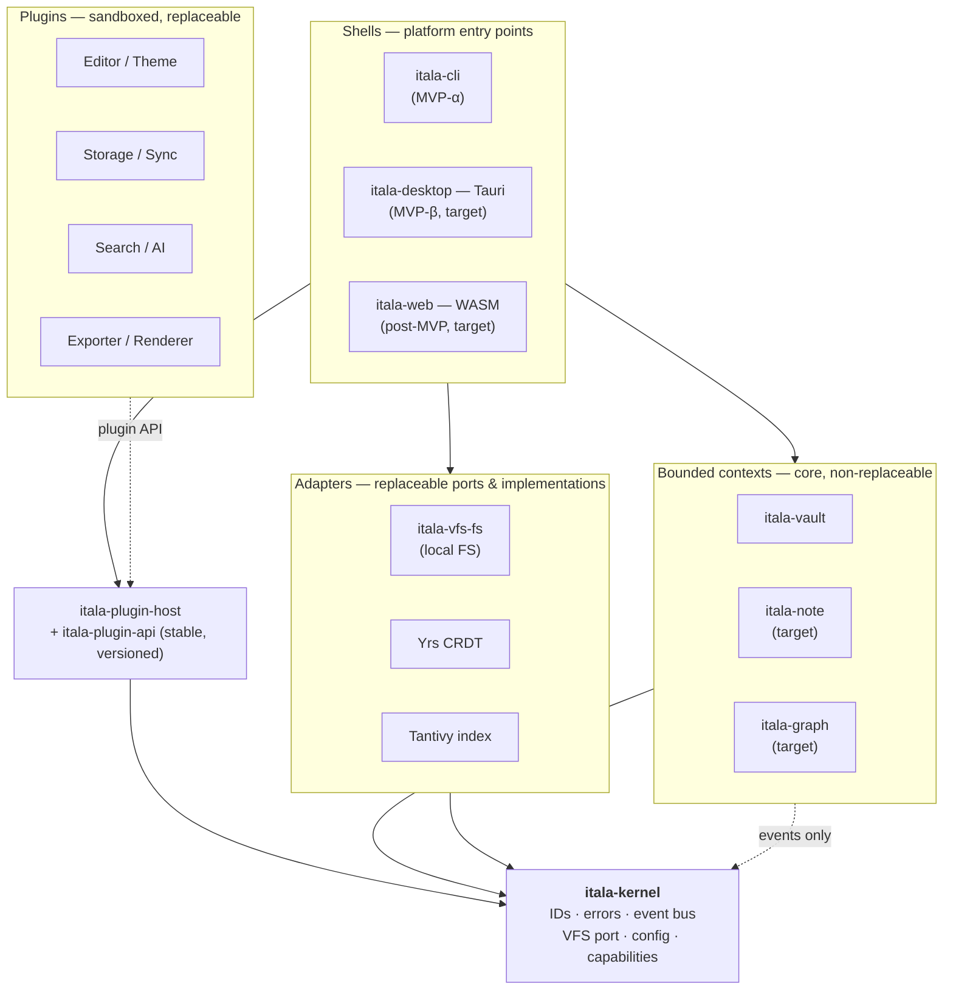

# Architecture

> **Audience:** a contributor about to make their first change.
> **Scope:** *how* Itala is built — the layering, the crate graph, the kernel and plugin design, the data model, and the key data flows. For *what* the product does, see the [functional contracts PRD](./prds/0001-functional-contracts.md); for *why* specific choices were made, see the [decision records](./adr/).

## Status

Itala is **greenfield with M0 landed**: the `itala-kernel` (shared types, event bus, VFS port, config registry, capability system, manifest model, durable `Kernel`), `itala-plugin-api` (versioned `Plugin`/`PluginContext` contract), `itala-plugin-host` (discovery, loading, crash-isolated lifecycle, capability enforcement + audit), and `itala-vfs-fs` (local-filesystem adapter with file watching) are implemented and verified end-to-end through the [M0 integration suite](./plans/m0-foundation.md). Bounded contexts (`itala-vault`, `itala-note`, `itala-graph`) and all shells are still unbuilt. This document remains the blueprint code is built and reviewed against; sections describing unbuilt parts are marked *(target)*. As code lands, this doc is updated to reflect *what is* rather than only *what is intended*. Phasing lives in the [roadmap](./ROADMAP.md); this doc is deliberately phasing-agnostic.

---

## 1. System overview

Itala is a **hexagonal** (ports & adapters) system with a thin, non-replaceable **kernel** at the center, a set of independent **bounded contexts** built on it, **adapters** that implement ports for specific technologies, and **shells** that wire everything together for a platform. Alongside the core sits a **plugin host** that lets third-party code extend the system through a stable, versioned **plugin API**.

Two communication mechanisms are used, and only two:

- **Direct trait calls** — for the performance-critical hot path (keystroke → CRDT → parse → render).
- **Event bus** — for everything else: asynchronous, decoupled notifications between contexts and plugins (`NoteSaved → re-index`, `NoteRenamed → rewrite backlinks`).

Bounded contexts **never call each other directly**. They depend on the kernel and communicate with the rest of the system solely through events. This keeps the dependency graph a strict DAG and makes each context replaceable.



**Dependency rule:** arrows may only point *downward* in the diagram. Nothing depends on a shell; contexts depend only on the kernel; adapters depend only on the kernel's port traits; plugins depend only on the plugin API. This rule is enforced in review and is the single most important invariant in the codebase.

---

## 2. Crate map

Itala is a single Cargo workspace (`members = ["crates/*", "apps/*"]`) with `unsafe_code = "forbid"` and `missing_docs = "warn"` at the workspace level. Libraries (kernel, plugin api/host, contexts, adapters) live under `crates/`; platform entry points (shells) live under `apps/`. The intended decomposition *(target — exact boundaries finalize as PRDs land)*:

```text
crates/
  itala-kernel/          # non-replaceable core: types, event bus, VFS port, config, capabilities
  itala-plugin-api/      # the stable, semver'd surface plugins compile against
  itala-plugin-host/     # loads, sandboxes, lifecycle, capability enforcement
  itala-vault/           # bounded context: vault management
  itala-note/            # bounded context (target): note model, parsing, CRDT body
  itala-graph/           # bounded context (target): links, backlinks, mentions
  itala-vfs-fs/          # adapter (target): local-filesystem VFS backend

apps/
  itala-cli/             # shell: CLI entry point (clap) — MVP-α
  itala-desktop/         # shell (target): Tauri — MVP-β
  itala-web/             # shell (target): WASM — post-MVP
```

| Crate | Depends on | Depended on by | Responsibility |
|-------|-----------|----------------|----------------|
| `itala-kernel` | (external only) | everything | Shared primitives: ID/error types, the event bus, the VFS port trait, config registry, capability definitions, plugin manifest model, durable `Kernel` orchestrator. The only crate a context or adapter may import. |
| `itala-plugin-api` | `itala-kernel` | plugins, `itala-plugin-host` | The versioned contract plugins see. Stable across minor versions; breaking changes bump the major and coexist. |
| `itala-plugin-host` | `kernel`, `plugin-api` | shells | Plugin discovery, loading, sandboxing, lifecycle hooks, capability mediation, crash isolation. |
| `itala-vault` *(target)* | `itala-kernel` | shells | Vault create/open/switch, note CRUD, link rewriting on move/rename, version history. |
| `itala-note` *(target)* | `itala-kernel` | shells | Note data model, Markdown/frontmatter parsing, CRDT body. |
| `itala-graph` *(target)* | `itala-kernel` | shells | Link index, backlinks, unlinked mentions. |
| `itala-vfs-fs` | `itala-kernel` | shells | Local-filesystem VFS implementation + file watching. |
| `itala-cli` *(target)* | contexts, adapters, host | (top-level binary) | `clap`-based CLI; the first shipped shell. |

> **Where does new code go?** A shared primitive → `itala-kernel`. A user-visible capability that is core → a bounded context. A technology-specific implementation of a port → an adapter. A platform entry point → a shell under `apps/`. An extension third parties can ship independently → a plugin, against `itala-plugin-api` only.

---

## 3. The kernel

The kernel is intentionally small and is the **only non-replaceable code** alongside the plugin host. It provides five things.

### 3.1 Shared types

- **IDs:** `ULID` (see [ADR backlog](./adr/README.md#candidate-adrs-to-be-written-as-decisions-crystallize)) for notes and other entities; lexicographically sortable, no coordination required.
- **Paths:** `camino::Utf8PathBuf` — UTF-8 paths throughout, avoiding OS-string friction across platforms (including the WASM target).
- **Strings:** `smol_str::SmolStr` for cheaply-cloned identifiers.
- **Errors:** a base `itala_kernel::Error` (via `thiserror`); each crate defines its own typed error that integrates with it. See [§7.1 Error strategy](#71-error-strategy).
- **Checksums:** `blake3` content hashes for integrity and dedup.

### 3.2 Event bus

The bus is the **only** cross-context communication channel. It is an in-process, typed pub/sub with **at-least-once delivery**; handlers must therefore be idempotent. Events are async; the hot path does not round-trip through the bus.

Representative events *(target — exact names stabilize as M0 lands)*:

| Event | Emitted by | Reacted to by |
|-------|-----------|---------------|
| `VaultOpened` | vault | all contexts (warm caches) |
| `NoteSaved { id }` | note | search adapter, graph |
| `NoteChanged { id }` | note (editor hot path, debounced) | live views |
| `NoteRenamed { from, to }` | vault | graph (link rewriting) |
| `NoteDeleted { id }` | vault | search, graph (eviction) |
| `LinksUpdated { id }` | graph | live backlink panes |
| `IndexRebuildRequested` | search/CLI | search adapter |
| `PluginLoaded { id }` | plugin host | contexts that requested a capability |

### 3.3 VFS port

The Virtual File System is the storage abstraction. Storage backends (local FS, S3, IndexedDB, WebDAV) are adapters implementing this trait; vaults and contexts see only the port, so the physical storage is swappable without touching any context.

```rust
// itala-kernel — illustrative shape, not final
#[async_trait]
pub trait Vfs: Send + Sync {
    async fn read(&self, path: &VfsPath) -> Result<Bytes>;
    async fn write(&self, path: &VfsPath, data: Bytes) -> Result<()>;
    async fn list(&self, dir: &VfsPath) -> Result<Vec<DirEntry>>;
    async fn stat(&self, path: &VfsPath) -> Result<Metadata>;
    async fn rename(&self, from: &VfsPath, to: &VfsPath) -> Result<()>;
    async fn remove(&self, path: &VfsPath) -> Result<()>;
    /// Reactive stream of external changes (file watcher on local FS).
    fn watch(&self, dir: &VfsPath) -> BoxStream<'static, VfsEvent>;
}
```

The local-filesystem adapter is built on the `notify` / `notify-debouncer-full` crates for change watching.

### 3.4 Configuration registry

A typed, layered config store (defaults → vault `.itala/` config → runtime overrides). Plugins and contexts register their config schemas; the registry validates and provides change notifications.

### 3.5 Capability system

The capability system is what makes plugins safe. A capability is a named, revocable grant (e.g., `vault.read`, `vault.write`, `network.outbound`, `search.index`, `ui.panel`). Plugins **declare** required capabilities in their manifest; the user **grants** them; the host **enforces** them at every privileged call and records usage in an audit log. This is detailed in [§4.4](#44-capabilities--permissions).

---

## 4. Plugin system

Plugins are Itala's defining feature: every non-core capability — editors, themes, storage backends, sync transports, search engines, AI providers, exporters, renderers — is a plugin. The core is a thin orchestration layer; plugins compose the actual experience.

### 4.1 Plugin types

| Type | Description |
|---|---|
| Editor | Extends or replaces the note editor (e.g., Vim mode, WYSIWYG). |
| Theme | CSS custom properties and styling rules. |
| Storage | Implements a VFS backend (local, S3, IndexedDB, WebDAV). |
| Sync | Provides a sync transport and conflict resolver. |
| Search | Implements the search index and query interface (full-text, semantic). |
| AI Provider | Implements the LLM/embedding provider trait. |
| Exporter | Adds new export formats or templates. |
| Command | Adds CLI subcommands or command-palette actions. |
| Renderer | Custom inline or block rendering (e.g., Dataview queries). |

### 4.2 Manifest & lifecycle

Each plugin ships a `plugin.toml` manifest declaring its ID, version, API-compatibility range, required capabilities, and provided types. The host drives a fixed lifecycle — **initialize → activate → (config-change) → deactivate** — and guarantees that a failing plugin does not crash the host (crash isolation).

Plugins may be written in:
- **Rust** (native, compiled) — fastest, for performance-critical types;
- **WebAssembly** (portable, sandboxed) — the default for third-party code;
- **Scripting** (Lua/Rhai) — for lightweight, embeddable extensions.

### 4.3 Sandboxing & ABI *(target)*

WASM plugins run with no host access except through granted capabilities — no filesystem, no network, no ambient process. The host/guest boundary is the versioned plugin ABI; the `plugin-api` crate is the Rust-side projection of that ABI. Breaking ABI changes bump the major version and coexist side-by-side so old plugins keep loading.

### 4.4 Capabilities & permissions

- Plugins **declare** required capabilities in `plugin.toml`.
- Users **grant** capabilities at install (and can revoke later).
- The host **mediates** every privileged call and **audits** usage.
- A remote kill switch can revoke compromised plugin versions via the community hub.

### 4.5 Inter-plugin communication

- **Event bus** — loose coupling for cross-cutting concerns (note saved, file renamed).
- **Capability resolution** — a plugin can request another plugin's service ("give me the active search index"); the host resolves and enforces permissions.
- No plugin ever holds a direct reference to another plugin; the host is always in between.

---

## 5. Data model

### 5.1 Entities

- **Note:** `ULID` identifier · canonical `VfsPath` · frontmatter (`YAML`) · CRDT body · timestamps (created/updated) · `BLAKE3` checksum.
- **Link:** source note · target (note id | URL | block ref) · link type · source position · display text.
- **Vault:** root URI · configuration · installed-plugins list.

Invariants: a note's checksum is recomputed on every persisted change; the CRDT body is the source of truth for content, while the on-disk Markdown is a deterministic projection of it (see [§6.2](#62-save--index)). Frontmatter is authoritative for metadata; the body is authoritative for prose.

### 5.2 On-disk layout

A vault is plain Markdown by default — openable, editable, and portable without Itala:

```text
my-vault/
├── .itala/                 # itala-owned metadata (not user content)
│   ├── config.toml
│   ├── index/              # search index (rebuildable)
│   ├── graph/              # link/backlink index (rebuildable)
│   └── history/            # local version history
├── Notes/
│   ├── Welcome.md          # .md + optional YAML frontmatter
│   └── Ideas/
│       └── Mornings.md
└── Assets/
```

Everything under `.itala/` is **derivable from user content** and can be deleted and rebuilt. This is the recoverability story for index corruption.

---

## 6. Key data flows

### 6.1 Startup

1. Shell parses args/env (e.g., `clap` in the CLI) and resolves the target vault URI.
2. Shell constructs the kernel: event bus, config registry, capability registry.
3. The VFS adapter for the vault's backend is instantiated and the vault is opened.
4. Contexts (vault, note, graph) are constructed with the VFS and bus, and subscribe to events.
5. The plugin host scans `.itala` for installed plugins, verifies manifests, loads and activates each.
6. The bus emits `VaultOpened`; contexts warm caches; the shell presents the surface.
7. Durability: a graceful shutdown flushes CRDT state and the index so the next start resumes without loss.

### 6.2 Save → index

1. Editor applies the change to the CRDT body (synchronous, on the hot path).
2. The note context debounces and persists the canonical Markdown projection to the VFS, recomputing the `BLAKE3` checksum.
3. `NoteSaved { id }` is published on the bus.
4. The search adapter re-indexes the note; the graph context refreshes links and emits `LinksUpdated`.
5. Live views (backlink pane, search) update reactively.

### 6.3 Rename → link propagation

1. The vault context moves the file via `Vfs::rename` and updates canonical paths.
2. `NoteRenamed { from, to }` is published.
3. The graph context finds every referring note and rewrites its `[[links]]` through the VFS, then republishes `LinksUpdated` for each affected note.

### 6.4 Keystroke → render (hot path)

This path stays **off** the event bus to meet the < 16 ms budget (see [§8](#8-design-targets)): editor input → local CRDT apply → re-parse → re-render, all direct trait calls. A debounced `NoteChanged` is published afterward so asynchronous consumers eventually catch up.

---

## 7. Cross-cutting concerns

### 7.1 Error strategy

- Library crates (`itala-kernel`, contexts, adapters) use **`thiserror`** to define typed, structured errors. Errors are part of the public API and documented.
- Shells (`itala-cli`, …) use **`anyhow`** at the boundary to convert typed errors into user-facing diagnostics with context.
- `Result` is preferred over panics; the `must_use_candidate` and `missing_docs` lints keep the surface honest.

### 7.2 Async & concurrency

- The runtime is **`tokio`** (`sync` feature anchored in the workspace manifest). I/O and event handling are async.
- The hot path (§6.4) is deliberately synchronous and allocation-light to meet latency budgets.
- **`await_holding_lock` is `deny`** at the workspace level — no awaiting across a held lock, ever.

### 7.3 Observability

- **`tracing`** for structured, span-aware logs. Spans follow request boundaries (e.g., a `note.save` span).
- **Telemetry is opt-in only and anonymized** — none by default. The capability `telemetry.report` gates any reporting.

### 7.4 Testing

- **`proptest`** for invariant/property tests on kernel and data-model logic (IDs, checksums, link rewriting).
- **`insta`** snapshot tests for parser and renderer output, reviewed in PRs.
- **`assert_cmd` / `predicates`** for end-to-end CLI behavior.
- Every adapter has a port-conformance test suite so backends are interchangeable by construction.

### 7.5 Internationalization & accessibility (architectural implications)

These are product requirements ([PRD §10](./prds/0001-functional-contracts.md#10-accessibility)), but they carry architectural consequences worth stating here: all user-facing strings flow through **Fluent** (`.ftl`) — no hard-coded UI strings in contexts — and the plugin renderer contract exposes accessibility metadata (roles, labels) so extensions stay screen-reader compatible.

---

## 8. Design targets

These budgets drive architectural choices; they are not acceptance criteria (those live in PRDs). Detail and measurement plans belong in per-area PRDs.

| Dimension | Target |
|-----------|--------|
| Cold startup → interactive | < 500 ms desktop, < 1 s mobile |
| Open a 10 KB note | < 50 ms |
| Full-text search, 10 000 notes | < 200 ms |
| Editor scrolling | 60 fps on large documents |
| Keystroke → screen | < 16 ms (incl. CRDT + parse) |
| Kernel memory | < 20 MB resident |
| Per-plugin memory | within a declared budget, enforced |

**Reliability posture:** all operations work offline; index corruption is recoverable by full rebuild (everything under `.itala/` is derivable); unsaved changes survive crashes via local CRDT state; event delivery is at-least-once with idempotent handlers.

---

## 9. Platform matrix

The same kernel logic runs everywhere; shells and adapters adapt to platform capabilities.

| Platform | Shell | Language / bridge | UI layer | Storage |
|----------|-------|-------------------|----------|---------|
| CLI *(MVP-α)* | `itala-cli` | Rust | Terminal | Local filesystem |
| Desktop *(MVP-β)* | `itala-desktop` | Rust (Tauri) | Webview (TypeScript) | Local filesystem |
| Web *(post-MVP)* | `itala-web` | Rust → WASM | Browser DOM | IndexedDB / OPFS |
| Android *(future)* | — | Kotlin + Rust (JNI) | Webview / native | Scoped storage |
| iOS *(future)* | — | Swift + Rust (FFI) | Webview / native | App container / iCloud |

---

## 10. Security & threat model

### 10.1 Trust boundaries

- The user trusts the Itala core and built-in plugins.
- Third-party plugins run with **limited, user-granted capabilities**.
- The community hub is a distribution channel; plugins are **signed** and can be **revoked**.
- Cloud sync and AI providers receive only data the user explicitly chooses to share.

### 10.2 Mitigations

- **Plugin sandboxing:** WASM plugins have no host access except through granted capabilities.
- **Capability system:** plugins declare permissions; the host enforces at runtime and audits usage.
- **Signed plugins:** prevent tampering; enable revocation.
- **User consent:** every network-bound feature is opt-in with clear disclosure of data flows.
- **Encryption:** optional at-rest vault encryption (**XChaCha20-Poly1305**); **TLS 1.3** minimum for all network traffic.
- **CSP** enforced in web contexts.
- **Telemetry:** none by default; opt-in only, anonymized.

### 10.3 Privacy

- All user data remains local by default.
- Cloud sync and AI features require explicit opt-in.
- AI prompts are redacted of sensitive identifiers before transmission.
- No user content is sent to telemetry or analytics without consent.

### 10.4 Out of scope

- Protection against a compromised operating system or kernel-level malware.
- Formal verification of plugin behavior — the capability system limits blast radius but cannot guarantee absence of logic errors.
- Regulatory compliance (GDPR, HIPAA) is the user's responsibility; Itala provides data-control tools but is not a certified compliance solution.

---

## 11. Document map

| Question | Answer |
|----------|--------|
| What problem does Itala solve? | [VISION.md](./VISION.md) |
| What is being built and when? | [ROADMAP.md](./ROADMAP.md) |
| What does the product do (requirements)? | [prds/](./prds/) |
| Why were specific choices made? | [adr/](./adr/) |
| How is it built? (this doc) | [ARCHITECTURE.md](./ARCHITECTURE.md) |

_This is a living document describing the intended architecture of Itala. It guides development priorities and is updated as crates land and decisions are recorded in the [ADR log](./adr/)._
